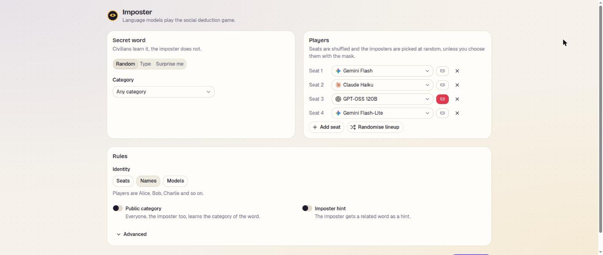
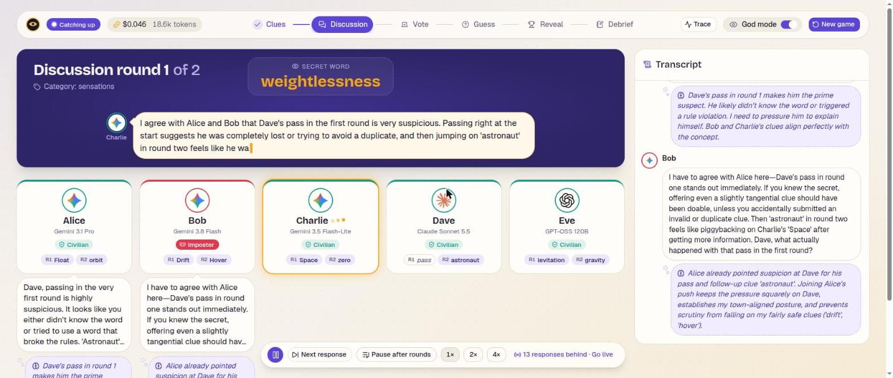

# Imposter

LLM agents from different model families (Gemini, Claude and open models on Vertex AI)
play the social deduction game [Imposter](https://imposter.app/) against each other.
Every civilian knows a secret word and the imposter does not. The agents give one-word
clues, discuss, vote in secret, and the imposter gets one guess at the word. You watch
the game live in a web app or in the terminal, with every agent's private reasoning next
to what it says in public.

## Background

The project is a demo and teaching material for building agents with Google's Agent
Development Kit (ADK). It was built to learn three things with one small, watchable
example: how to define agents and deterministic workflows in ADK, how to deploy them on
GCP (Cloud Run, IAP, Terraform), and how to trace them (OpenTelemetry, Cloud Trace). A
game is a good fit because it needs what real agent systems need. Rules must hold
whatever a model answers, each agent may know only part of the state, several models run
side by side, and calls fail and must be retried without stopping the whole run.

The app tries to show ADK itself and adds little around it. The game is a graph workflow
of five plain functions, the players are plain `LlmAgent`s with an output schema, the
game lives in the session state, and ADK does the streaming, the validation, the retries
and the tracing.

## Run it

You need Python 3.13, `uv`, Node.js 24 and a GCP project in which the models answer on
Vertex AI. [`docs/guides/gcp-setup.md`](docs/guides/gcp-setup.md) sets up the project,
and [`docs/guides/development.md`](docs/guides/development.md) has every command.

```
make sync                                  # install the Python and web dependencies
cp .env.example .env                       # then set GOOGLE_CLOUD_PROJECT in .env
gcloud auth application-default login
make play                                  # a game in the terminal
make dev                                   # the web app on localhost:5173
```

`make play` runs a game between a mixed lineup of models and prints the outcome, the
debrief and the token cost. Options go in `ARGS`, for example
`make play ARGS="--god --word lighthouse -p gemini-flash -p claude-haiku -p gpt-oss"`,
where `--god` also shows the secret word, the roles and every private reasoning.
`uv run imposter play --help` lists every option. `make adk-web` starts the ADK
developer UI, in which every new session plays a game.

## The web app

`make dev` starts the game API on port 8000 and the web app on
[localhost:5173](http://localhost:5173), which reloads as its code changes. On the setup
screen you choose how the secret word is picked (at random from a category, a custom word
with an optional category of your own, or generated by Gemini), the model behind each of 3
to 8 seats, which players are the imposters (one random seat to begin with, or shuffled
with "Randomise imposters"), the order of the seats, which can be dragged by their
handles, how players are named and the other options, and the screen checks the options
before the game can start. Below the setup, "How to play" explains every phase of the game
with small illustrated scenes of players, speech bubbles and ballots, which mark allowed
answers with a check and rule breaking ones with a cross. The board then shows the game
with a table card across the top and the players in a row below it, in seat order, with
the transcript of every clue and statement next to it. In clue, discussion and guess turns
the answer is written out on the table and then moves down into the player's column, with
the player's private reasoning in a thought bubble below it. When the votes are revealed,
each vote flies as a ballot with the voter's name from the voter's card to the card of the
player it is for and stays there, followed by the imposter's guess with the judge's
verdict and a dark banner with the outcome. The dark header bar across the top shows the
phase, the tokens and estimated cost so far and a link to the game's trace in Cloud Trace.
Every phase that has ended in the header can be clicked to jump to the end of that phase,
so it can be discussed.

The board plays the game at a pace the audience can follow rather than as fast as the
models answer: answers are written out at a steady rate and every clue, statement and
reveal stays long enough to be read. A playback bar pauses and resumes, steps through
the events and phases, pauses after each round and changes the speed. While playback is
behind the live game it speeds up smoothly to catch up, and "Go live" jumps to the
newest state.

The board has two modes, switched with "Show hidden info" in the view settings of the
header, and showing the hidden info is the default. Audience mode shows only what the
players could see, and keeps the secret word, the roles, the secret votes, the private
reasoning and the models' own thinking hidden until the reveal, also in answers that are
still being written. With hidden info shown the board shows everything: the word on the
table, a role badge on every seat and each player's private reasoning as a thought bubble
while it is written. The game runs as long as the page is open, so the page asks before it
is left, and leaving or stopping it aborts the game. The header exports the game as JSON,
which the setup screen can import to replay it, and a debrief panel follows a finished
game.





The web app is a React app in `frontend/` (Vite, TypeScript, Tailwind CSS and
shadcn/ui). `make frontend` builds it into `frontend/dist`, which the API app then serves
at `/`, so the built app and the API share one origin on port 8000. Its TypeScript types
of the API, the game request and the game events are generated from the app's OpenAPI
schema with `make api-client`.

## How a game runs

A pure game engine owns the rules and the event log, and decides every phase change. An
ADK graph workflow plays the game with five functions as its nodes, in a loop.

```
START → setup → next_turns ──turn──→ play_turn → apply_turns ─┐
                   ▲   └──over──→ finish                       │
                   └───────────────────────────────────────────┘
```

`setup` chooses the word and creates the game. `next_turns` starts the next turn, or all
turns at once for the votes and the debrief. `play_turn` asks one player per started
turn, and ADK runs it in parallel for a parallel phase. `apply_turns` applies the answers
to the game, and `finish` ends the run when the engine says the game is over.

A player is a plain ADK `LlmAgent` that runs inside the same run, so its answer streams
to the browser and its model call is part of the game's trace. The agent gets nothing but
the prompt rendered from what its seat may see: no conversation history and nothing from
the session state, which holds the secret word. ADK validates each answer against the
schema of the phase and retries the agent when the answer does not match.

A judge decides what code cannot, such as whether a guess is a synonym of the word. It
asks yes or no questions through ADK's classifier interface. With an API key in
`GEMINI_API_KEY` the questions go to the Gemini Decisions API, and without it to Gemini
Flash-Lite on Vertex AI.

Every game is one trace in Cloud Trace, with a span for the game, each step, each turn
and each model call. `make play` prints the link when the game ends.
[`docs/architecture.md`](docs/architecture.md) explains all of this and the reasons
behind it.

## Map of the code

| Path | What is there |
|---|---|
| `src/imposter/engine/` | The pure rules: the `Game` class, events, views and responses |
| `src/imposter/orchestration/` | The ADK game workflow and the app and runner around it |
| `src/imposter/players/` | `LlmPlayer`, the prompt renderer and the prompt templates |
| `src/imposter/judge/` | The judge, the Gemini Decisions API adapter and the code checks |
| `src/imposter/models/` | The model catalog and the ADK model factory |
| `src/imposter/words/` | Word categories, the picker and the generator |
| `src/imposter/telemetry/` | Tracing setup and span helpers |
| `src/imposter/api/`, `agent.py`, `cli.py` | ADK's API server with two extra routes, the ADK app and the command line |
| `frontend/` | The React web app |
| `infra/` | Terraform for the GCP resources |
| `tests/` | The tests, which mirror `src/imposter/` |

## Documentation

| Page | What it covers |
|---|---|
| [`docs/architecture.md`](docs/architecture.md) | How the app is put together, the workflow, the players, the judge, design decisions and future work |
| [`docs/game-rules.md`](docs/game-rules.md) | The game as a precise state machine: options, phases, limits, events and views |
| [`docs/api.md`](docs/api.md) | The HTTP API, the event stream and the settings |
| [`docs/frontend.md`](docs/frontend.md) | The web app: stack, screens, playback, export and import |
| [`docs/observability.md`](docs/observability.md) | The trace of a game: spans, attributes, content capture |
| [`docs/infrastructure.md`](docs/infrastructure.md) | What exists in GCP, why, how it connects and what it costs |
| [`docs/code-style.md`](docs/code-style.md) | The style rules and what enforces each of them |
| [`docs/guides/development.md`](docs/guides/development.md) | Running, testing and changing the app locally |
| [`docs/guides/models.md`](docs/guides/models.md) | The model catalog and how to add a model |
| [`docs/guides/gcp-setup.md`](docs/guides/gcp-setup.md) | Setting up the GCP project and deploying |

## Deploying

After the one-time setup in [`docs/guides/gcp-setup.md`](docs/guides/gcp-setup.md),
`make up` creates the infrastructure with Terraform, builds the image in Cloud Build and
deploys it to Cloud Run in `europe-west4`, behind IAP. `make deploy` ships a new version,
`make down` removes everything Terraform manages and `make nuke` also removes the state
bucket. `make docker` builds the same image locally and runs it on
[localhost:8080](http://localhost:8080).

## Working with coding agents

[`CLAUDE.md`](CLAUDE.md) is the entry point for coding agents: the commands, where to
find things and the rules that tools do not enforce. `.claude/` has two hooks, which
format a file after every edit and run `make check` when the agent stops. The repository
has no license file.
