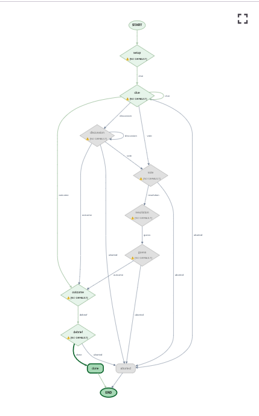

# Imposter

LLM agents from different model families (Gemini, Claude, open models on Vertex AI) play
the social deduction game [Imposter](https://imposter.app/) against each other. A demo for
exploring Google's Agent Development Kit (ADK), deployment on GCP (Cloud Run, IAP,
Terraform) and tracing (OpenTelemetry, Cloud Trace).

## Play a game

With `.env` set up (see below), `make play` runs a game in the terminal between a mixed
lineup of models and prints the outcome, the debrief and the token cost. Options go in
`ARGS`, for example `make play ARGS="--god --word lighthouse -p gemini-flash -p
claude-haiku -p gpt-oss"`, where `--god` also shows the secret word, the roles and every
private reasoning. `uv run imposter play --help` lists every option. `make adk-web`
starts the ADK developer UI, in which every new session plays a game.

## How a game runs

A pure game engine owns the rules and the event log, and decides every phase change. The
game is played by an ADK graph workflow with one node per phase (setup, clue,
discussion, vote, resolution, guess, outcome, debrief, done and aborted). The edges are
generated from the engine's table of phase transitions, so the graph shows every way a
game can go: the clue and discussion rounds are loop edges, a player who says the secret
word jumps straight to the outcome, and any phase in which players act can be aborted.
Each node plays its phase through the players, publishes the new game events and routes
to the phase that the engine moved to.

In the ADK developer UI (`make adk-web`), the graph shows the path a game took and
highlights the phase of the selected event. ADK traces every node, so a game is one
trace with a span per phase and round, and the model calls of the players nest under it.

## Design and setup

The design notes and decisions behind the app are in [`docs/plans/`](docs/plans/README.md).

To set up the app's infrastructure in the GCP sandbox project, follow [`docs/setup.md`](docs/setup.md).
[`docs/infrastructure.md`](docs/infrastructure.md) documents what is created in GCP, why,
and how it connects.
