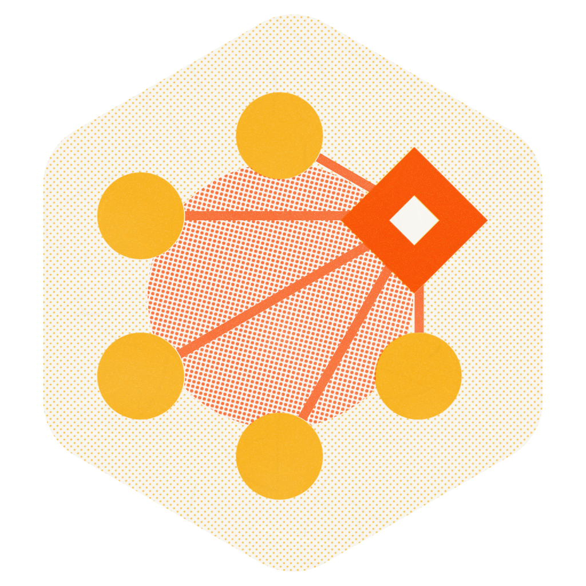
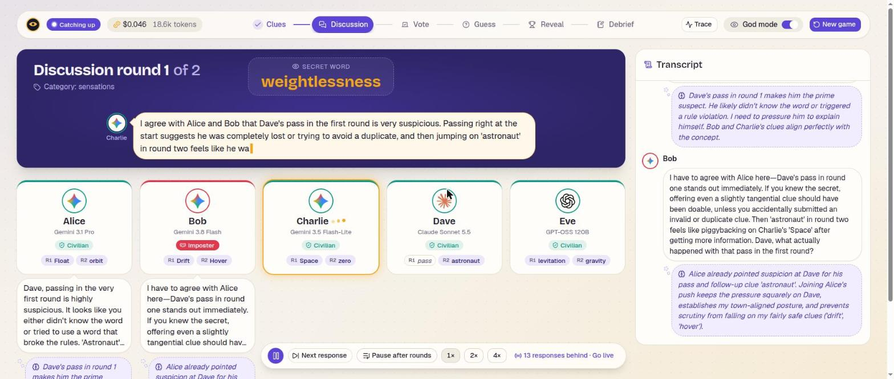

<p align="center">

</p>

# Imposter

In Imposter, most players know a secret word while one has to bluff without it.
Players give clues, discuss their suspicions, and vote on who they think the imposter is.
This project puts LLM agents around the same table to explore how different models play,
with a deterministic game engine controlling the rules and traces showing how each game
unfolds.



The board above shows hidden information for the viewer. The agents do not get that
view. Each civilian knows the word, while an imposter receives only the public clues and
statements, its own role, and its own earlier reasoning. Votes remain private until they
are revealed together. An optional public category or imposter hint changes what players
know without sharing their private scratchpads.

## Background

This project explores how AI agents perform at the social deduction game Imposter. It also
provides a setting for experimenting with agent design principles such as deterministic
workflows and tracing. The game works well for both because a clue has to convince other
players without giving away the word, and a plausible accusation can still point to the
wrong person, so every decision depends on what an agent knows and what it infers from
the others. The public conversation can be read next to each agent's reported reasoning
and the debrief where players explain their choices after learning the truth. That
reasoning is text the model generates, so it offers a clue about a decision without
proving how it was made.

On the engineering side, the models choose their actions while code controls turn order,
information boundaries, voting, and phase transitions. No model has to act as game
master, the rules can be tested without calling a model, and the same game runs in a
terminal, the live web app, or the ADK developer UI. Because the workflow has a fixed
structure, every game produces traces with the same phases, turns, model calls, and judge
decisions, which makes games easier to compare and debug.

## Getting started

You need **Python 3.13, uv, Node.js 24 or later, npm, and Make**. From the repository root,
install the dependencies and run the tests without calling real models or exporting
cloud telemetry.

```sh
make sync
IMPOSTER_TELEMETRY=none make test
uv run imposter play --help
```

### Run a live game

**Live games make paid Vertex AI calls, including judge calls and optional word
generation.** They require a Google Cloud project with billing, the Vertex AI API enabled,
Application Default Credentials with permission to call the models, and access to every
model you select. Partner and open models may require accepting terms in Model Garden.
The default lineup is defined in
[`orchestration/setup.py`](src/imposter/orchestration/setup.py), and model IDs and locations
are listed in the [model catalog](src/imposter/models/catalog.yaml).

Follow the authentication and model-access steps in [the cloud setup guide](docs/setup.md)
if the project is not ready, then configure local credentials and settings.

```sh
gcloud auth application-default login
gcloud auth application-default set-quota-project YOUR_PROJECT_ID
cp .env.example .env
# Edit .env and set GOOGLE_CLOUD_PROJECT to YOUR_PROJECT_ID.
make dev
```

Open <http://localhost:5173> to choose a word, assign models to 3–8 seats, and start a game.
The API runs on port 8000. The board streams answers, tracks estimated token cost, and
supports playback and JSON export/import. Hidden information is shown by default, so
switch it off for an audience that should discover the imposter with the players.

For a terminal game, use `make play`. Pass options through `ARGS` to choose the lineup or
show the secrets and reported private reasoning.

```sh
make play ARGS="--god --word lighthouse -p gemini-flash -p claude-haiku -p gpt-oss"
```

The prices in the catalog are estimates, not a spending cap. Turning telemetry off does
not disable model calls. Cloud telemetry is enabled by the example `.env` and captures
prompts and completions, so review the [tracing and privacy notes](docs/running.md#tracing)
before using sensitive words or sharing exports.

## How it works

A game normally moves through clue rounds, discussion, a secret vote, an imposter guess,
and a debrief. Clues must be single words and cannot repeat earlier clues. Saying the
secret word during clues or discussion loses the game for the speaker's side. An
uncaught imposter wins, while a caught imposter can steal the win by guessing the word.
The [game rules](docs/plans/game-rules.md) cover ties, multiple imposters, and other options.

The [engine](src/imposter/engine/game.py) owns an append-only event log and derives the
current state and each [player's view](src/imposter/engine/views.py) from it. It performs
no model calls or other I/O. An [ADK graph workflow](src/imposter/orchestration/runner_workflow.py)
runs the phases and routes according to the engine's transitions. Player agents receive
fresh, seat-specific prompts rather than a shared conversation history, and a separate
judge handles semantic questions such as whether a guess is a synonym of the word.
The control flow is deterministic, but model answers and semantic judgments are not.

Gemini is called through its native client, while Claude and the catalog's open models
use LiteLLM through Vertex AI. The React frontend consumes the ADK event stream, and the
API serves the built frontend and game endpoints from one origin in production.
OpenTelemetry connects the game, phases, turns, model calls, and judge decisions so that
retries and token usage can be inspected alongside the conversation.

## Playback and deployment

The [running guide](docs/running.md) covers audience and hidden-information views,
playback, replay files, the API, containers, and tracing. `make adk-web` opens the ADK
developer UI for inspecting the workflow rather than the audience-facing board.

Deployment is optional. The [cloud setup guide](docs/setup.md) walks through the required
project permissions and model access, and the [infrastructure guide](docs/infrastructure.md)
describes Terraform resources, IAP access, costs, rollback, and removal. The supplied
Cloud Run deployment uses IAP to admit only the configured principals. It is not a public,
unauthenticated game service. Budget alerts warn about spending but do not stop it.

## Limitations and future work

Games and sessions are held in memory, and a live game depends on its streaming request.
Leaving the page or stopping the stream aborts the game, while restarting the server
loses its in-memory state. Export a game to keep a replay. Audience mode hides information
in the interface, not in the underlying stream or export, and is not a security boundary.

This is a demo for inspecting model behavior, not a controlled model-ranking benchmark.
A seed fixes randomized setup choices, not model responses, and reported reasoning is
model-generated text rather than proof of how a decision was made. Model availability,
quotas, and catalog prices need checking in your own project before a live run.

Persistent storage, analytics, remote A2A players, human player seats, and voice are
[future-work ideas](docs/plans/future-work.md), not current capabilities. The
[design notes](docs/plans/README.md) also contain historical proposals, including a
tournament CLI that is not implemented in the current command interface.

## Development

`make test` runs the Python tests excluding those marked `slow`, then the frontend tests.
`make test-slow` exercises real models and requires credentials and paid API access.
`make check` formats and lints code, checks types, and validates Terraform when installed.
It can modify files through its formatters and lint fixes.

Use `make frontend` to build the web app into `frontend/dist`, then
`uv run imposter serve --telemetry none` to serve the build locally without cloud
telemetry. `make api-client` regenerates the frontend's types from the API's OpenAPI
schema. See the [tooling notes](docs/plans/tooling.md) for conventions and hooks.

## License

This repository does not currently include a license file.
