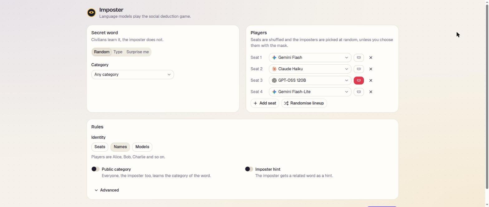
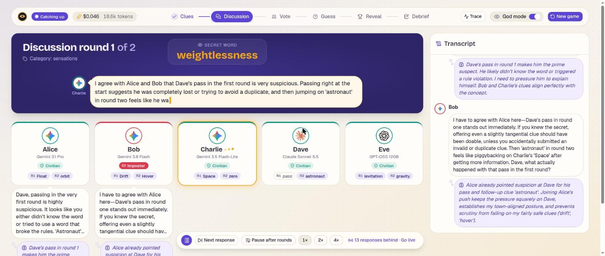

# Imposter

LLM agents from different model families (Gemini, Claude, open models on Vertex AI) play
the social deduction game [Imposter](https://imposter.app/) against each other. A demo for
exploring Google's Agent Development Kit (ADK), deployment on GCP (Cloud Run, IAP,
Terraform) and tracing (OpenTelemetry, Cloud Trace).

## Play a game

With `.env` set up (see below), `make play` runs a game in the terminal between a mixed
lineup of models and prints the outcome, the debrief and the token cost. Options go in
`ARGS`, for example `make play ARGS="--god --word lighthouse -p gemini-flash -p
claude-haiku -p gpt-oss"`, where `--god` also shows the secret word, the roles and every
private reasoning. `uv run imposter play --help` lists every option. `make adk-web`
starts the ADK developer UI, in which every new session plays a game.

## Web app

`make dev` starts the game API on port 8000 and the web app on
[localhost:5173](http://localhost:5173), which reloads as its code changes. On the setup
screen you choose how the secret word is picked (at random from a category, typed, or
made up by Gemini), the model behind each of 3 to 8 seats, which players are the
imposters (one random seat to begin with, or shuffled with "Randomise imposters"), how
players are named and the other rules, and the screen checks the options before the game
can start. The board then shows the game with a table card across the top and the
players in a row below it, in seat order, with the transcript of every clue and
statement next to it. In clue, discussion and guess turns the answer is written out on
the table and then moves down into the player's column, with the player's private
reasoning in a thought bubble below it. The votes are revealed as arrows drawn between
the players, followed by the imposter's guess with the judge's verdict and a banner with
the outcome. The header shows the phase, the tokens and estimated cost so far and a link
to the game's trace in Cloud Trace.

The board plays the game at a pace the audience can follow rather than as fast as the
models answer: answers are written out at a steady rate and every clue, statement and
reveal stays long enough to be read. A playback bar pauses and resumes, plays one
response at a time, pauses after each round and changes the speed. While playback is
behind the live game it speeds up smoothly to catch up, and "Go live" jumps to the
newest state.

The board has two modes, and god mode is the default. Audience mode shows only what the
players could see, and keeps the secret word, the roles, the secret votes, the private
reasoning and the models' own thinking hidden until the reveal, also in answers that are
still being written. God mode shows everything: the word on the table, a role badge on
every seat and each player's private reasoning as a thought bubble while it is written.
The game runs as long as the page is open, so the page asks before it is left, and leaving
or stopping it aborts the game. Export and import and a debrief panel are planned.

The web app is a React app in `frontend/` (Vite, TypeScript, Tailwind CSS and
shadcn/ui). `make frontend` builds it into `frontend/dist`, which the API app then serves
at `/`, so the built app and the API share one origin on port 8000. Its TypeScript types
of the API, the game request and the game events are generated from the app's OpenAPI
schema with `make api-client`.

## Container

The `Dockerfile` builds the image that runs the app: a Node stage builds the web app, a
uv stage installs the package, and a slim Python image serves both with uvicorn on
`$PORT` (8080 by default). `make docker` builds the image and runs it on
[localhost:8080](http://localhost:8080) with `.env` and the gcloud application default
credentials mounted, so a real game plays in the container.

## Deploying

After the one-time setup in [`docs/setup.md`](docs/setup.md), `make up` creates the
infrastructure with Terraform, builds the image in Cloud Build and deploys it to Cloud Run
in `europe-west4`. The service is private, so `make proxy` opens it on
[localhost:8081](http://localhost:8081) with your own credentials. `make deploy` ships a
new version, `make down` removes everything Terraform manages and `make nuke` also removes
the state bucket. [`docs/infrastructure.md`](docs/infrastructure.md) lists the resources,
their costs and how to roll back.

## Game API

The backend is ADK's own API server for the game app, plus a `/catalog` route that lists
the models, the word categories and the default lineup, and a `/traces/{game_id}` route
with the Cloud Trace link of a game. A game is an ADK session: the client creates a
session with the game options in its state, then plays it with `POST /run_sse`, which
streams the game while it runs. Every game event comes as an ADK event with the event in
its custom metadata, a "turn started" event says whose turn it is before the model
answers, and with `"streaming": true` every answer streams token by token as it is
written. The game runs as long as that request is open and is aborted when the client goes
away. [`docs/plans/web-ui.md`](docs/plans/web-ui.md) describes the stream in detail.

## How a game runs

A pure game engine owns the rules and the event log, and decides every phase change. The
game is played by an ADK graph workflow with one node per phase (setup, clue,
discussion, vote, resolution, guess, outcome, debrief, done and aborted). The edges are
generated from the engine's table of phase transitions, so the graph shows every way a
game can go: the clue and discussion rounds are loop edges, a player who says the secret
word jumps straight to the outcome, and any phase in which players act can be aborted.
Each node plays its phase through the players, one turn at a time or all seats at once
for the votes and the debrief, publishes each game event as it happens and routes to the
phase that the engine moved to. Every turn runs in a turn node of its own, and the
player's agent runs as a child node of the turn, inside the same run.

In the ADK developer UI (`make adk-web`), the graph shows the path a game took and
highlights the phase of the selected event.

## Tracing

Every game is one trace in Cloud Trace. ADK traces the workflow and every node, so the
trace has a root span for the game and a span per phase and round. ADK also traces every
model call, with its token usage, and below it every HTTP attempt of the call is a span
with its status code, so retries after a timeout or a rate limit are visible. The app
puts the turn attributes on ADK's span of each turn node and adds a span per judge
decision, and the model calls of the players nest under their turn. The root span carries the lineup and the outcome, and the
secret word only as a hash, so a list of traces does not spoil it. `make play` prints
the Trace Explorer link of the game when it ends.

The prompts and completions are logged by ADK itself, with no code of ours: three
environment variables (`OTEL_INSTRUMENTATION_GENAI_CAPTURE_MESSAGE_CONTENT=EVENT_ONLY`,
`ADK_CAPTURE_MESSAGE_CONTENT_IN_SPANS=false` and
`OTEL_SEMCONV_STABILITY_OPT_IN=gen_ai_latest_experimental`) make ADK write one Cloud
Logging entry per model call, with the prompt, the answer and the tokens, and the trace
and span id of the call. The app sets them as defaults. In Logs Explorer, the query
`logName:"gen_ai.client.inference.operation.details" trace="<trace id>"` lists the
entries of one game.

Traces go to Cloud Trace when `GOOGLE_CLOUD_PROJECT` is set. `IMPOSTER_TELEMETRY` (or the
`--telemetry` option) chooses `cloud`, `console` to print the spans in the terminal, or
`none`.

## Design and setup

The design notes and decisions behind the app are in [`docs/plans/`](docs/plans/README.md).

To set up the app's infrastructure in the GCP sandbox project, follow [`docs/setup.md`](docs/setup.md).
[`docs/infrastructure.md`](docs/infrastructure.md) documents what is created in GCP, why,
and how it connects.
