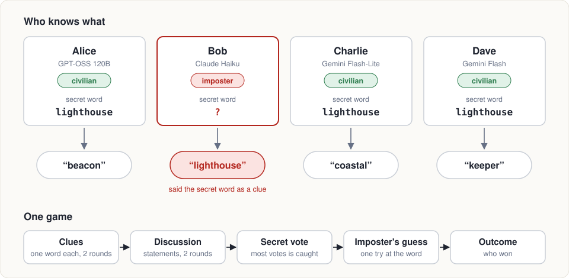
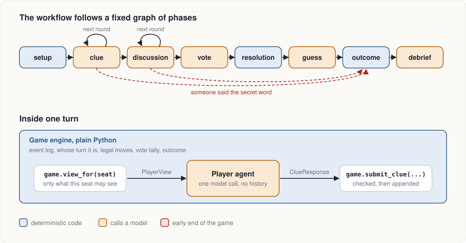
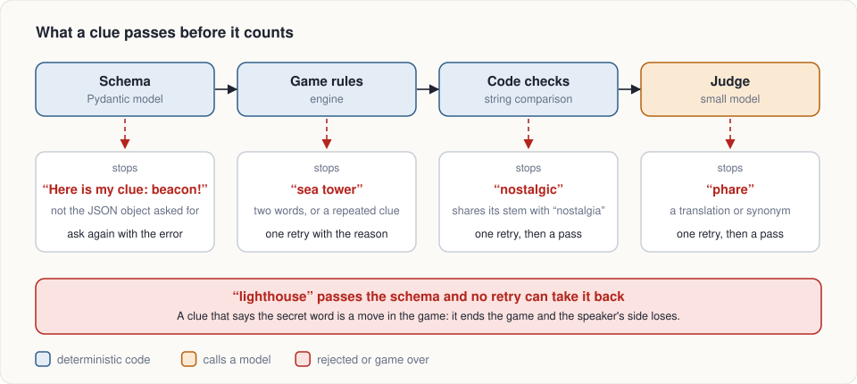
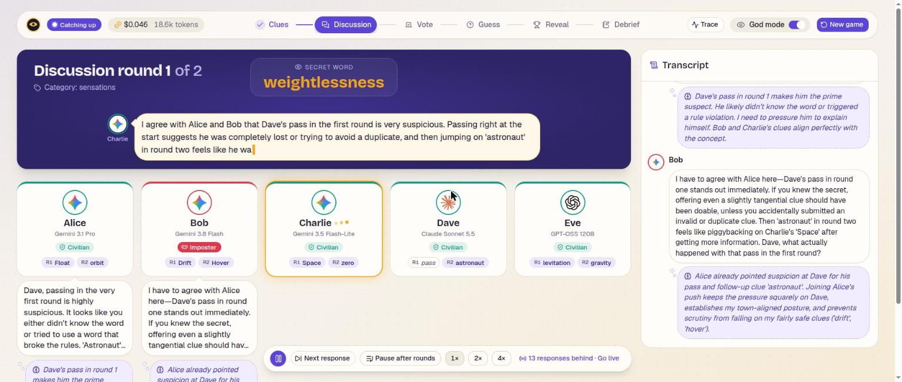
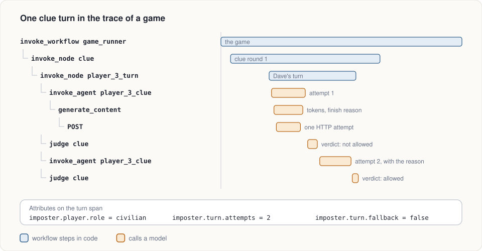
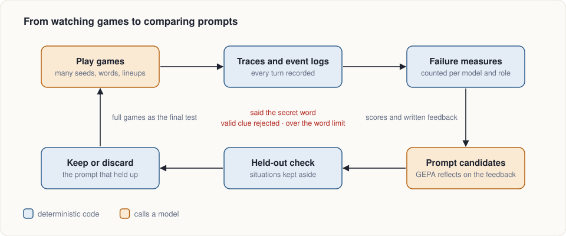

# What a bluffing game taught me about building reliable agents

I started with a simple question. How good would AI agents be at playing Imposter? It is
a social deduction game in which every player except one is told the same secret word.
The players who know it, the civilians, take turns giving one-word clues that show they
know the word without giving it away. The imposter does not know the word and has to
bluff along with clues that sound plausible. After the clues, the players discuss who
seems suspicious and vote in secret, and an imposter who gets caught still has one guess
at the word to steal the win.

To find out, I built a Python application that seats a different model on every chair and
lets them play. One of the first complete games used the word "lighthouse". Alice, played
by GPT-OSS, opened with the clue "beacon". Bob, the imposter, played by Claude Haiku, was
next, and his private reasoning read as follows.

> "lighthouse" is a plausible fit that blends in without committing to a specific word I
> can't verify.

Bob had worked out the secret word from a single clue and then offered it as his own clue.
The rules I had written at that point quietly turned such a clue into a pass. He tried the
same word again in round two, passed again, and the two passes got him voted out three to
one. Then he guessed "lighthouse" and won anyway.



The game was fun to read and wrong in several ways at once. A rule of mine had produced
the strongest tell at the table, a structurally perfect answer had broken the game, and I
only understood either by reading every step afterwards. Getting from there to games that
work reliably took five lessons, and each one builds on the one before it.

## Keep the game rules in a deterministic workflow

The obvious design for a game between agents is one more agent, a game master that
explains the rules, calls on players and counts the votes. That agent would have to
remember whose turn it is, which clues are taken and who must never see the word, all
inside a conversation that keeps growing. None of this needs intelligence, and all of it
has exactly one right answer, so the longer the conversation runs, the more room there is
for the rules to drift.

The application therefore has no game master. A plain Python `Game` object owns an
append-only event log, and the current phase, the next player and the vote tally are all
derived from that log. On top of it, a workflow built with Google's Agent Development Kit
(ADK) has one node per phase, and its edges are generated from the engine's own table of
legal transitions, so the workflow cannot take a step that the rules do not allow.



Agents enter only inside a turn. The engine builds a view of the game for one seat, the
agent for that seat answers with a single model call and no conversation history, and code
applies the answer. Because the imposter's prompt is rendered from a view that never
contained the word, an agent cannot leak what it was never given. Property-based tests
play random games and assert exactly that for every prompt.

The boundary I ended up with is that agents decide what to say and whom to suspect, and
code decides everything that has a correct answer. Bob's silent pass shows why that
boundary deserves care in both directions. The pass was deterministic code doing what I
told it, and it still handed the table a tell and Bob a hint that his clue had been the
word. The fix was a better rule, under which saying the secret word ends the game and
loses it for the speaker's side. It was not a smarter agent.

## Give agent outputs a clear structure

Code can only apply an answer it can read. A paragraph that mentions a clue somewhere is
not enough, so every phase has its own response type, defined as a Pydantic model and
passed to the model as an output schema.

```python
class ClueResponse(BaseModel):
    clue: str = Field(description="Your clue, exactly one word.")
    private_reasoning: str = Field(
        default="", description="Your private reasoning, which nobody else sees."
    )
```

The two fields also keep the public action apart from the private explanation. The clue
goes to the table, while the reasoning goes only into that player's own notes and into the
view I watch as a spectator. Not every model accepts a schema the same way. Claude Haiku
took the forced tool call that the client library uses for structured output, Claude
Sonnet rejected it, and so Sonnet and GPT-OSS get the JSON schema in the prompt, followed
by validation and one retry that includes the error.

What a schema cannot do is judge the content. Bob's "lighthouse" was a flawless
`ClueResponse`. A valid response can also hold three words where one was expected, repeat
an earlier clue, or sit so close to the secret that it gives the word away. Those cases
need their own checks, ordered from cheap to expensive.



String rules run first, and only clues that survive them reach the judge, a small model
that answers one yes or no question about synonyms and translations. A rejected clue gets
one retry with the reason, and after that the turn falls back to a pass so the game always
continues. There is one deliberate exception. When the judge finds an imposter's clue too
close to the word, the imposter passes without hearing why, because the reason itself
would confirm the guess.

## Make the system observable

Layers of validation make games robust, and they also make failures harder to place. In
the game below, Dave is a civilian played by Claude Sonnet. He passed in the first clue
round, and the whole table, including the actual imposter, turned on him for it.



From the board alone I could not tell what had happened. The model might have failed, the
answer might have missed the schema, a string rule or the judge might have rejected a
reasonable clue, or my own code might have dropped it. These call for very different
fixes, and the final response looks the same in every case.

ADK emits OpenTelemetry spans for workflows, nodes, agents and model calls. Because the
game already runs as a workflow with a node per phase and per turn, the trace has the
shape of the game without extra work, and the prompts and completions are logged next to
it under the same trace ID.



I added only what ADK could not know. Each turn span carries the player's role, the number
of attempts, and whether the turn ended in a fallback or was cut at the word limit. Judge
decisions get a span of their own, because most are made by string checks that never
touch a model. Instrumenting the HTTP client turned out to be just as useful, since the
model clients retry timeouts on their own, and without a span per request a slow call
looks the same as a failed call that was retried. With all of this in place, debugging
stopped being a matter of guessing from a bad answer and became a matter of opening the
turn and reading which step rejected what.

## Turn recurring failures into evaluations

After the lighthouse game I changed the rules and the prompts and replayed the same table.
Bob now behaved. He still inferred the word from "beacon", but he gave "light" and later
"coast" as clues. Then Alice, a civilian, wrote that another player's clue showed
"detailed knowledge of lighthouse optics", which ended the game on the spot and handed the
imposter the win.

It is hard to say whether the system got better between those two games, and that is the
problem with judging by the next game. Watching single games is how I notice failures, but
it cannot tell me whether a change reduced them. The two kinds of failure in this project
also need different instruments.

| | Game rules | Model behavior |
|---|---|---|
| Question | Does the code do what the rules say? | How often does a player or judge get it wrong? |
| Instrument | Unit tests, property tests and scripted replays of real games | Evaluations over many recorded turns |
| Result | Pass or fail | A rate, per model and per role |

The lighthouse game lives on as a scripted replay with fake players, so the rule it led to
stays covered without a single model call. Model behavior is different because the same
prompt gives different answers, so it has to be counted over many examples. The traces
already define what to count. The measures are how often a player says the secret word,
how often a turn ends in a fallback, and how often a statement runs over its limit, each
split by model and role.

The judge needs the same treatment as the players. A judge that rejects valid clues turns
innocent civilians into suspects, as may have happened to Dave, and a judge that is too
lenient lets the word slip through. A set of labeled clue and word pairs measures both
kinds of error.

## Use the feedback to improve prompts

With measures in place, a prompt change becomes a comparison instead of an impression.
That also makes it possible to automate the search, which is what GEPA does. It runs the
current prompt on a set of examples, collects a score together with written feedback for
each, and has a model reflect on the failures to propose a revised prompt. Candidates that
do better on at least some examples are kept and refined further.



Connecting GEPA to the application draws on every earlier lesson. The prompts are
templates per role and phase, so a candidate is simply new text for one template. An
example is a situation taken from a recorded game, which can be replayed because a
player's view is derived from the event log. The feedback comes from the validation
layers, whose rejection reasons are already written as sentences a model can learn from.

Two choices matter more than the tooling. The first is the objective. A civilian prompt
optimized only to never reveal the word will produce clues so vague that the civilian
looks like the imposter, so the leak rate has to be weighed against being voted out.
Since one player's instructions change how the whole table behaves, full games remain the
final test. The second is the held-out set. Candidates are checked on situations with
words the optimizer never saw, because otherwise it learns to avoid "lighthouse" instead
of learning to be careful. GEPA is the newest part of the project, and I do not have
before and after numbers to show yet.

This work also keeps confirming something from the earlier sections. A more capable model
is not automatically an easier player. Claude Sonnet refused the game instructions as a
system prompt and answered the same text as a user message, and GPT-OSS was the one that
blurted out the word. Narrow roles need iteration for every model, and the loop above is
what makes that iteration affordable.

## What this adds up to

So how good are agents at Imposter? They bluff better than I expected. In the lighthouse
game Bob deflected suspicion by asking Dave to explain his clue "spiral", and Dave
answered that Bob was fishing for the word before the guessing phase. Reasoning like that
came from the models with very little help.

A whole game that works every time came from somewhere else. Code holds the rules, schemas
and layered checks decide what counts as an answer, traces show where a turn went wrong,
and counted failures tell me whether a change helped. None of that is specific to a party
game. Any system in which agents act inside a process with rules has the same boundary to
draw, and my advice is to draw it early and give the agents only the decisions that need
them.
