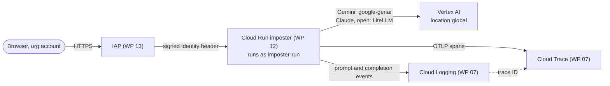
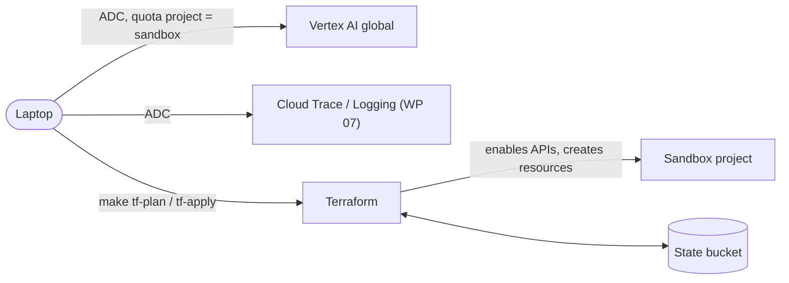

# GCP infrastructure

What the app creates in GCP, and why. Setup steps are in [`setup.md`](setup.md); the
design and decisions behind it are in [`plans/infrastructure.md`](plans/infrastructure.md)
and D17 in [`plans/README.md`](plans/README.md). Keep this page in sync with `infra/`:
every change to the Terraform updates the tables below in the same PR.

## Where it lives

Everything goes into the owner's **existing sandbox project**, which other work shares.
The app does not create or own the project, its billing link or its IAM policy as a whole.
GCP has no resource groups, so the app's resources are kept apart by:

| Mechanism | How |
|---|---|
| Label `app=imposter` | Set on every resource that supports labels, through the providers' `default_labels` (`infra/providers.tf`). Filter on it in the console, in billing reports and with `gcloud asset search-all-resources --query="labels.app=imposter"`. |
| Name prefix `imposter` | Every resource name starts with it. |
| Terraform state | `terraform -chdir=infra state list` is the exact list of what the app manages; `terraform destroy` touches nothing else. |

Region: app resources in `europe-west4` (D31). Models are called at the Vertex AI `global`
location, which is not a resource.

## How it connects

Three flows use the infrastructure: playing a game, deploying a new version, and running
the app or Terraform locally. Parts marked *(WP n)* are planned and not created yet.

### Playing a game (deployed)

1. The browser opens the Cloud Run URL. **IAP** checks the org Google login and lets only
   the allowed principals through (`roles/iap.httpsResourceAccessor`); IAP itself calls
   Cloud Run with `roles/run.invoker`, nobody else can. IAP passes the user's identity in a
   header, which the app puts on the root span (`enduser.id`).
2. **Cloud Run** serves the static page and the API, and streams the game over SSE. A
   game runs while that request is open, which is why the timeout is 3600 s.
3. For each turn the app calls **Vertex AI** as the service account `imposter-run`
   (`roles/aiplatform.user`). There are no API keys: the Google client libraries take the
   service account credentials from the Cloud Run metadata server. Gemini is called
   natively, Claude and open models through LiteLLM; all at `global` unless the model
   catalog sets a regional location.
4. **OpenTelemetry** exports spans to **Cloud Trace** through the telemetry API
   (`roles/cloudtrace.agent`, `roles/telemetry.tracesWriter`) and writes prompts and
   completions to **Cloud Logging** (`roles/logging.logWriter`), linked by trace ID.

### Deploying (`make deploy`, WP 12)

Cloud Build builds the image in GCP from the local source and pushes it to Artifact
Registry. Terraform then points the Cloud Run service at that exact image digest, so a
rollback is an apply with an earlier digest. Terraform reads and writes its state in the
state bucket on every run.

### Local development

Locally everything runs as the owner: the app, `scripts/check_models.py` and Terraform
use ADC from `gcloud auth application-default login`. The ADC quota project and
`GOOGLE_CLOUD_PROJECT` in `.env` point at the sandbox project, so calls are billed there.
Terraform additionally bills its own API calls to the project (`user_project_override`).

## Created outside Terraform

| Resource | Created by | Why |
|---|---|---|
| GCS bucket `<project id>-imposter-tfstate` (`europe-west4`, label `app=imposter`) | `make tf-state-bucket` (`gcloud`) | Holds the Terraform state under the prefix `imposter`, so it survives a lost laptop and can be shared. Terraform needs the bucket before it can run, so it cannot create it itself. Versioning keeps every earlier state for recovery; uniform access and public access prevention keep it private. |
| Model enablement for Claude and open models | Owner, in the Model Garden console | Partner and open models need their terms accepted once per project; there is no API for it. |
| Quota increases | Owner, on the Quotas page | Default per-model quotas can be too low for 8 players. |

## Managed by Terraform (`infra/`)

### Enabled APIs (`infra/apis.tf`)

Enabling an API costs nothing; usage is billed. In a shared project some are likely
enabled already. Terraform never disables them, not even on destroy
(`disable_on_destroy = false`), because other work may depend on them.

| API | Why | Used from |
|---|---|---|
| `aiplatform.googleapis.com` | Vertex AI: Gemini, Claude and open models for players, judge and word generator | WP 02 (model check), WP 04 |
| `serviceusage.googleapis.com` | Lets Terraform enable APIs; also needed to bill API calls to the project (`user_project_override`) | WP 02 |
| `cloudresourcemanager.googleapis.com` | Lets Terraform read the project and manage its IAM bindings | WP 02, WP 12 |
| `iam.googleapis.com` | Runtime service account `imposter-run` | WP 12 |
| `artifactregistry.googleapis.com` | Docker repository for the app image | WP 12 |
| `cloudbuild.googleapis.com` | Builds the image in GCP (`make build`), no local Docker | WP 12 |
| `run.googleapis.com` | Cloud Run service that hosts API, UI and SSE | WP 12 |
| `billingbudgets.googleapis.com` | Budget with email alerts | WP 12 |
| `iap.googleapis.com` | Identity-Aware Proxy in front of Cloud Run (org Google login) | WP 13 |
| `cloudtrace.googleapis.com` | One trace per game (game → phase → turn spans) | WP 07 |
| `telemetry.googleapis.com` | OTLP endpoint for OpenTelemetry traces | WP 07 |
| `logging.googleapis.com` | Prompts and completions as log events linked to the trace | WP 07 |

### Provider settings (`infra/providers.tf`)

| Setting | Why |
|---|---|
| `default_labels = { app = "imposter" }` | Makes every labelled resource findable in the shared project (variable `labels`). |
| `billing_project` + `user_project_override = true` | API calls count against this project's quota and billing, not the quota project of whoever runs Terraform. |
| `google` and `google-beta` pinned to `~> 8.9`, lock file committed | Reproducible plans; beta is there for IAP on Cloud Run if it needs it. |

### Planned resources

Not created yet; this table moves up into the sections above when they land.

| Resource | Why | WP |
|---|---|---|
| Service account `imposter-run` with `roles/aiplatform.user`, `roles/cloudtrace.agent`, `roles/logging.logWriter` (and `roles/telemetry.tracesWriter` if needed) | Least-privilege identity of the Cloud Run service; no owner or editor roles | 12 |
| Artifact Registry repository `imposter` (`europe-west4`) | Stores the app images; deploys pin an image digest | 12 |
| Cloud Run service `imposter` (min 0, max 1 instance, request-based billing, 3600 s timeout) | Hosts the app and scales to zero (D11, D14) | 12 |
| Billing budget, filtered on `app=imposter` | Warns at 50/90/100% of the monthly amount; does not cap spend (D29) | 12 |
| IAP on the Cloud Run service, `roles/iap.httpsResourceAccessor` for the allowed principals | Only the owner (or a group) can reach the app (D12) | 13 |

## Costs

| Item | Cost |
|---|---|
| APIs | Free to enable. |
| State bucket | Kilobytes of state; effectively free. |
| Vertex AI model calls | Per token, by far the largest cost. Not labelled, so they show under the *Vertex AI* service in billing reports. |
| Cloud Run, Artifact Registry, Cloud Build, Trace, Logging (WP 07+) | Small at demo usage; Cloud Run costs nothing while scaled to zero. |

## Removing the app

1. `terraform -chdir=infra destroy` removes every Terraform-managed resource. APIs stay
   enabled.
2. Delete the state bucket last, if wanted: `gcloud storage rm --recursive
   gs://<project id>-imposter-tfstate`.
3. Model Garden enablement can stay; it costs nothing without calls.
