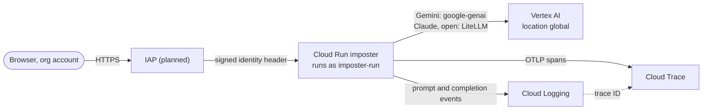
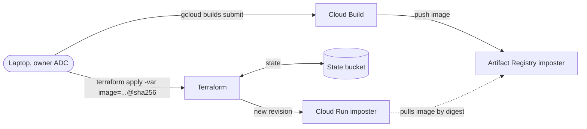
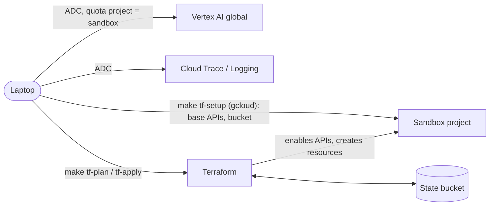

# GCP infrastructure

This page describes the infrastructure the app creates in GCP, explains why each part
exists and shows how the parts connect. The steps to set it up are in
[`setup.md`](setup.md). Whenever the Terraform in `infra/` changes, the tables below
change with it, so that this page always describes what actually exists.

## Where it lives

Everything goes into the owner's **existing sandbox project**, which is shared with other
work. The app does not create or own the project, its billing link or its IAM policy as a
whole. GCP has no resource groups, so the app keeps its resources apart from the rest of
the project in three ways:

| Mechanism | How it works |
|---|---|
| Label `app=imposter` | The providers set this label on every resource that supports labels, through `default_labels` in `infra/providers.tf`. You can filter on it in the console, in billing reports and with `gcloud asset search-all-resources --query="labels.app=imposter"`. |
| Name prefix `imposter` | The name of every resource starts with `imposter`. |
| Terraform state | `terraform -chdir=infra state list` shows exactly which resources the app manages, and `terraform destroy` touches nothing else. |

The app's resources live in the region `europe-west4`, close to its European users. The
models are called at the Vertex AI location `global`, which is an endpoint and not a
resource in the project.

## How it connects

Three flows use the infrastructure: playing a game, deploying a new version, and running
the app or Terraform locally. Parts marked *(planned)* are designed but do not exist yet.
Until IAP arrives, the Cloud Run service is private: nobody holds `allUsers` invoker
access, and you reach it with `make proxy`, which runs `gcloud run services proxy` with
your own credentials.

### Playing a game (deployed)

1. The browser opens the Cloud Run URL. **IAP** checks the org Google login and only lets
   the allowed principals through, because they hold `roles/iap.httpsResourceAccessor`.
   IAP then calls Cloud Run with `roles/run.invoker`, which nobody else has. It passes the
   user's identity in a header, and the app records it on the root span as `enduser.id`.
2. **Cloud Run** serves the static page and the API, and it streams the game to the
   browser over SSE. A game runs for as long as that request is open, which is why the
   request timeout is 3600 seconds.
3. For each turn, the app calls **Vertex AI** as the service account `imposter-run`, which
   holds `roles/aiplatform.user`. No API keys are involved, because the Google client
   libraries get the service account credentials from the Cloud Run metadata server.
   Gemini is called natively, and Claude and the open models are called through LiteLLM.
   All calls go to `global` unless the model catalog sets a regional location for a model.
4. **OpenTelemetry** exports the spans to **Cloud Trace** through the telemetry API, using
   `roles/cloudtrace.agent` and `roles/telemetry.tracesWriter`. It also writes the
   prompts and completions to **Cloud Logging** with `roles/logging.logWriter`, and the
   trace ID links each log entry to its trace.

### Deploying (`make deploy`)

`make deploy` first lets Terraform create the registry and the build account when they are
missing, because nothing can be built without them. Cloud Build then builds the image in
GCP from the local source code, using `cloudbuild.yaml` and the account `imposter-build`,
and pushes it to Artifact Registry. The source is staged in the bucket
`<project id>-imposter-build`, which deletes objects after seven days. The target then
looks up the digest of the pushed image, and Terraform points the Cloud Run service at
that exact digest. On every run, Terraform reads and writes its state in the state
bucket.

To roll back, list the earlier images with `gcloud artifacts docker images list
europe-west4-docker.pkg.dev/<project id>/imposter/app --include-tags` and apply one of
their digests again with `make deploy-image IMAGE=<repo>/app@sha256:...`. Cloud Run
creates a new revision for it, and no build is needed. The cleanup policy of the
registry keeps the ten newest images and deletes older ones after 30 days, so a rollback
target must still be in that window.

### Local development

On a laptop, everything runs as the owner. The app, `scripts/check_models.py` and
Terraform all use the Application Default Credentials (ADC) that `gcloud auth
application-default login` creates. Both the ADC quota project and `GOOGLE_CLOUD_PROJECT`
in `.env` point at the sandbox project, so all calls are billed to it. Terraform also
bills its own API calls to the project through `user_project_override`. For that to work,
the Service Usage API must already be enabled in the project, which is why `make tf-setup`
enables it with `gcloud` before Terraform runs for the first time.

A game played on a laptop exports its trace with the same ADC, over OTLP to the
telemetry API, and writes the prompts and completions to Cloud Logging. The owner's
account already holds the roles to write traces and logs, so this needs no extra setup.

## Created outside Terraform

A few things have to exist before Terraform can run, or cannot be created through an API
at all. They are set up by `make tf-setup` or by hand.

| Resource | Created by | Why it exists |
|---|---|---|
| The APIs `serviceusage`, `cloudresourcemanager` and `storage` | `make tf-setup`, with `gcloud services enable` | Terraform bills its API calls to the project through `user_project_override`, which only works when the Service Usage API is already enabled in the project. Terraform cannot enable that API for itself. The first two APIs are also listed in `infra/apis.tf`. |
| The GCS bucket `<project id>-imposter-tfstate` in `europe-west4`, labelled `app=imposter` | `make tf-setup`, with `gcloud` | The bucket holds the Terraform state under the prefix `imposter`, so the state survives a lost laptop and can be shared. Terraform needs the bucket before it can run, so it cannot create the bucket itself. Versioning keeps every earlier state for recovery, and uniform access and public access prevention keep the bucket private. |
| Model enablement for Claude and the open models | The owner, in the Model Garden console | Partner and open models need their terms accepted once per project, and there is no API for doing that. |
| Quota increases | The owner, on the Quotas page | The default per-model quotas can be too low for a game with eight players. |

## Managed by Terraform (`infra/`)

### Enabled APIs (`infra/apis.tf`)

Enabling an API costs nothing, and only its usage is billed. In a shared project, some of
these APIs are probably enabled already. Terraform never disables them, not even on
`terraform destroy`, because `disable_on_destroy = false` protects other work that may
depend on them.

| API | Why the app needs it | Used for |
|---|---|---|
| `aiplatform.googleapis.com` | Vertex AI serves the Gemini, Claude and open models for the players, the judge and the word generator. | Model calls |
| `serviceusage.googleapis.com` | Terraform uses it to enable the other APIs and to bill its own API calls to the project. `make tf-setup` enables it first. | Terraform |
| `cloudresourcemanager.googleapis.com` | Terraform uses it to read the project and to manage its IAM bindings. `make tf-setup` enables it first. | Terraform |
| `iam.googleapis.com` | Terraform uses it to create the runtime service account `imposter-run`. | Deployment |
| `artifactregistry.googleapis.com` | Artifact Registry stores the Docker images of the app. | Deployment |
| `cloudbuild.googleapis.com` | Cloud Build builds the image in GCP for `make build`, so no local Docker is needed. | Deployment |
| `run.googleapis.com` | Cloud Run hosts the service that serves the API, the UI and the SSE stream. | Hosting |
| `billingbudgets.googleapis.com` | The budget sends email alerts when spending passes its thresholds. | Cost control |
| `iap.googleapis.com` | Identity-Aware Proxy puts the org Google login in front of Cloud Run. | Access control (planned) |
| `cloudtrace.googleapis.com` | Cloud Trace stores one trace per game, with spans for the game, its phases and its turns. | Tracing |
| `telemetry.googleapis.com` | The telemetry API is the OTLP endpoint that receives the OpenTelemetry traces. | Tracing |
| `logging.googleapis.com` | Cloud Logging stores the prompts and completions as log events that link to their trace. | Tracing |

### Provider settings (`infra/providers.tf`)

| Setting | Why it is set |
|---|---|
| `default_labels = { app = "imposter" }` | Every resource that supports labels gets this label, which makes it easy to find in the shared project. The value comes from the variable `labels`. |
| `billing_project` and `user_project_override = true` | API calls count against the quota and billing of this project, not against the quota project of whoever runs Terraform. |
| `google` and `google-beta` pinned to `~> 8.9`, with the lock file committed | Pinned versions make plans reproducible. The beta provider is there in case IAP on Cloud Run needs it. |

### Identity and access (`infra/iam.tf`)

| Resource | Why it exists |
|---|---|
| The service account `imposter-run` with `roles/aiplatform.user`, `roles/cloudtrace.agent`, `roles/logging.logWriter` and `roles/telemetry.tracesWriter` | It is the least-privilege identity of the Cloud Run service, and it has no owner or editor roles. It can call Vertex AI and export traces and logs, and nothing else. |
| The service account `imposter-build` with `roles/logging.logWriter` on the project, `roles/artifactregistry.writer` on the repository and `roles/storage.objectViewer` on the build bucket | Cloud Build runs as this account instead of the broad default one, so a build can only write logs, push images and read the uploaded source. |
| The bucket `<project id>-imposter-build` in `europe-west4` | `make build` uploads the source here for Cloud Build, and objects expire after seven days. |
| `roles/run.invoker` for the principals in the variable `invokers` | It lets chosen people call the private service, for example through `make proxy`. Project owners do not need it, and IAP replaces it later. |

### Deployment and hosting

| Resource | Why it exists |
|---|---|
| The Artifact Registry repository `imposter` in `europe-west4` (`infra/registry.tf`) | It stores the app images, and every deploy pins one image by its digest. A cleanup policy keeps the ten newest images and deletes older ones after 30 days. |
| The Cloud Run service `imposter` (`infra/run.tf`) with 0 to 1 instances, 1 vCPU, 1 GiB, request-based billing, concurrency 80 and a 3600 second timeout | It hosts the app and scales to zero when nobody uses it. A game runs inside one long request, which is why the timeout is an hour. The service only exists once the variable `image` is set, which `make deploy` does. It sets the Vertex AI and telemetry variables, including the content capture settings. |

### Budgets (`infra/budget.tf`)

Budgets are created when the variable `billing_account_id` is set. They warn at 50, 90 and
100% of the monthly amount, by email to the billing admins and to `budget_emails`, but they
do not cap spending.

| Resource | Why it exists |
|---|---|
| The budget `imposter app resources`, filtered on the label `app=imposter` | The project is shared, so the label counts only the spend of the app's own resources, such as Cloud Run and Artifact Registry. |
| The budget `imposter vertex ai (whole project)`, filtered on the Vertex AI service | Model calls carry no resource labels, so the label filter cannot see them, and they are the largest cost. This budget counts all Vertex AI spend in the project, including other work, and it can be turned off with `vertex_budget_amount = 0`. The service ID is set in `infra/budget.tf` and should be checked in the billing console. Claude models from Model Garden may be billed under their own service and are not covered. |

### Planned resources

| Resource | Why it will exist |
|---|---|
| IAP on the Cloud Run service, with `roles/iap.httpsResourceAccessor` for the allowed principals | It makes sure that only the owner, or a chosen group, can reach the app. |

## Costs (excluding model tokens)

This estimate assumes demo use: about 50 games a month that last about 10 minutes each,
about 10 deploys a month, and a Cloud Run service with 1 vCPU and 1 GiB of memory. The
prices are USD list prices for `europe-west4` as known in October 2026. They were not
checked against the live pricing pages, so confirm them with the
[pricing calculator](https://cloud.google.com/products/calculator) before relying on them.

Several free tiers apply per billing account rather than per project. The sandbox billing
account is shared with other work, so others may already have used them up. The last
column of the table therefore shows the cost when no free tier is left.

| Item | What drives the cost | Free tier per month | Cost after the free tier |
|---|---|---|---|
| Enabled APIs | Nothing, because enabling an API is free. | Not needed | $0 |
| State bucket | A few KB of state and its earlier versions. | 5 GB, but only in US regions | Below $0.01 a month |
| Cloud Run | CPU and memory while a request is open. A 10 minute game uses about 600 vCPU-seconds and 600 GiB-seconds. | 180,000 vCPU-seconds, 360,000 GiB-seconds and 2 million requests per billing account, which covers about 300 games | About $0.016 per game at $0.000024 per vCPU-second and $0.0000025 per GiB-second, so about $0.80 for 50 games |
| Artifact Registry | Stored images of about 0.3 GB each. Keeping five of them takes about 1.5 GB. | 0.5 GB | About $0.10 per GB-month, so $0.10 to $0.20 a month |
| Cloud Build | About 3 build minutes per deploy. | 2,500 build minutes | About $0.003 per minute, so about $0.10 for 10 deploys |
| Cloud Trace | A few hundred spans per game. | 2.5 million spans per billing account | $0.20 per million spans, so below $0.01 |
| Cloud Logging | A few MB of prompts and completions per game. | 50 GiB per project, shared with the rest of the project | $0.50 per GiB, so below $0.10 |
| IAP (planned) and the budget | Nothing, because both are free. | Not needed | $0 |
| Network egress | Page loads and the SSE stream, which amount to a few MB. | A small free amount | Below $0.01 |

Added up, this gives three figures:

- **Idle:** The app costs $0.10 to $0.20 a month, mostly for stored images. Cloud Run
  costs nothing while it is scaled to zero.
- **Demo use (50 games and 10 deploys):** The app costs close to $0 a month while the free
  tiers last, and about $1 to $1.50 a month without them.
- **Hard ceiling:** Cloud Run runs at most one instance and only bills while a request is
  open. Even a game that ran nonstop for a whole month would cost about $70, which is 2.6
  million seconds at about $0.0000265 per second for 1 vCPU and 1 GiB. The budget
  alerts warn long before that point.

Model tokens dominate the total. A single game with several premium models probably costs
more than a month of all the infrastructure above. Two settings keep the infrastructure
cost low: a cleanup policy on Artifact Registry that keeps only the last few images,
and `max_instance_count = 1` with request-based billing on Cloud Run.

## Setting up and removing the app

`make up` does the whole setup after the manual prerequisites in [`setup.md`](setup.md):
it runs `make tf-setup` and then `make deploy`, and prints the service URL. Because the
service is private, `make proxy` opens it on `http://localhost:8081`.

`make down` runs `terraform destroy` after asking for confirmation, which removes every
resource that Terraform manages, including the build bucket and its contents. The APIs
stay enabled, the state bucket stays, and the models stay enabled in Model Garden, so
`make up` works again right away. `make nuke` does the same and then also deletes the
state bucket with every earlier state, which leaves nothing of the app in the project
except the Cloud Build records and the traces and logs, which expire by themselves.
You can leave the models enabled in Model Garden, because enablement costs nothing without
calls.
