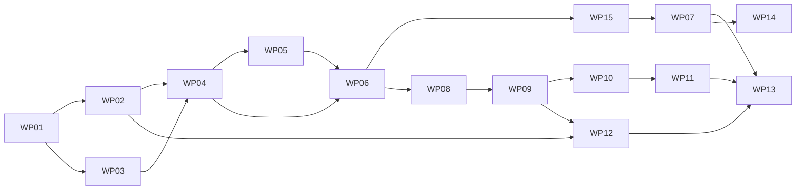

# Imposter project plan

This folder is the main context for the project. Every implementation session starts here.
It describes what we are building, why, the decisions made, the target repo structure, and
the order in which work happens. Topic files go deeper on each area:

| File | Covers |
|---|---|
| [`game-rules.md`](game-rules.md) | The game as a precise state machine: setup options, phases, limits, vote tally, guess, outcome, debrief |
| [`agents-and-orchestration.md`](agents-and-orchestration.md) | ADK setup, how engine, players and orchestration fit, the turn loop, the game workflow, `PlayerProtocol`, `PlayerView`, prompts, structured outputs, scratchpad, concurrency, failures, ports |
| [`models-and-judge.md`](models-and-judge.md) | Model catalog, Vertex AI access (Gemini, Claude, open MaaS models), identity modes, words and categories, the `Judge` |
| [`observability.md`](observability.md) | OpenTelemetry, Cloud Trace span hierarchy, content capture to Cloud Logging, token usage, IAP identity |
| [`web-ui.md`](web-ui.md) | ADK's API server with the event stream a client reads, React frontend (Vite, TypeScript, Tailwind, shadcn/ui), setup screen, game board, audience and god mode, playback, export and import |
| [`infrastructure.md`](infrastructure.md) | GCP basics, organising resources in the shared sandbox project, Terraform layout, Cloud Run, IAP, budget, Dockerfile, `make deploy` |
| [`tooling.md`](tooling.md) | Code style, ruff/ty/pytest, custom checkers, Makefile, pre-commit, Claude Code hooks (mirrors the hive repo) |
| [`playtests.md`](playtests.md) | Real games worth remembering: transcripts, findings and the rule changes they led to |
| [`future-work.md`](future-work.md) | Designed-for but not planned: personas, A2A players, Agent Engine, persistence, Laya judge, CI/CD, ... |

Work is split into **work packages** (WPs), each tracked as a GitHub issue that contains a
self-contained session prompt. The entry point for a session is: *"Implement issue #N"*.

---

## 1. Vision

A demo app in which LLM agents from different model families play the social deduction
game **Imposter** ([imposter.app](https://imposter.app/)) against each other, built to
explore **ADK agent definitions**, **GCP deployment** and **tracing** using best practices.

- You pick or generate a **secret word**, choose **3–8 players**, each backed by a model
  (Gemini, Claude, open models such as Llama, Qwen, DeepSeek or Mistral, all on Vertex AI),
  and start the game.
- Every civilian learns the word, the imposter does not. Agents give one-word clues over two
  rounds, discuss in two rounds (accusations and rebuttals, at most 100 words each), vote
  in secret, and the imposter gets one guess at the word.
- Agents record short **private reasoning** at every turn. After the game, every agent is
  asked to **reflect** on its clues and votes, knowing the true roles. In-the-moment
  reasoning and after-the-fact reflection are shown side by side.
- The game streams live to a good-looking web page (SSE). You can follow live, step through
  the buffered events, autoplay at a chosen speed, switch between **audience mode** (secrets
  hidden until the reveal) and **god mode** (everything visible), and export or import a
  game as JSON.
- Every game is a single trace in **Cloud Trace** with phases and turns as child spans,
  prompts and completions in Cloud Logging, and token usage per model call.
- Deployed to **Cloud Run** in `europe-west4`, behind **IAP** (org Google login), managed
  with **Terraform**, scaling to zero.

Audience: the owner, for learning, and colleagues during demos or talks (see D1).

## 2. Scope and non-goals

In scope: everything in the milestones below. Single game at a time, in memory.

Out of scope for now, documented in [`future-work.md`](future-work.md): personas, A2A
remote players, Agent Engine deployment, persistence (Firestore, BigQuery leaderboard),
concurrent games, CI/CD, a self-hosted Laya judge, ADK's eval framework, OpenAI models,
public multi-user access.

## 3. Architecture overview

```
 browser (React app, built into the same container and served at /)
    │  GET /catalog    POST /apps/imposter/users/{user}/sessions (request in state)
    │  POST /run_sse (streaming: engine events, turn starts, token deltas)
    ▼
 ┌──────────────── Cloud Run service `imposter` (europe-west4, behind IAP) ─────────────────┐
 │ api: ADK's API server (get_fast_api_app) + /catalog ── sessions (in memory)              │
 │    │                                                                                     │
 │    └──▶ orchestration: game workflow (ADK graph Workflow, a node per phase)              │
 │              │   GameRunner: ask players (I/O) → apply to the pure Game engine            │
 │              │   each turn a PlayerTurnNode, the player's agent a child node of it        │
 │              ├──▶ players: AdkPlayer (LlmAgent, include_contents='none') × N              │
 │              ├──▶ judge: Gemini Flash-Lite (structured yes/no)                           │
 │              └──▶ words: categories + Gemini word generator                               │
 │ telemetry: OpenTelemetry ──▶ Cloud Trace (spans), Cloud Logging (prompts/completions)     │
 └──────────────────────────────────────┬───────────────────────────────────────────────────┘
                                        ▼
                   Vertex AI (location `global`): Gemini, Claude (Model Garden), open MaaS models

 CLI: imposter play | imposter tournament   (same engine and players, no web)
```

Code is layered, and each layer imports only from the layers below it: `config` and `utils` ← `engine` ← `players` ← `orchestration` ← `api`,
with `models` (used by `players` and above) and `words`, `judge` and `ports` used by `orchestration` and `api`. `config.py`
and `utils/` hold the shared types and small helpers. `config`, `utils` and the engine use
only the standard library and pydantic: no ADK or LLM dependency. A test checks the
layers.

## 4. Decisions

| # | Decision | Rationale |
|---|---|---|
| D1 | Target audience is the owner plus colleagues in demos: a watchable live UI and a deployed URL, but no public multi-user app. | Learning value of ADK, deployment and tracing, without auth, rate limiting and abuse protection for strangers. |
| D2 | Game flow: setup → 2 clue rounds → 2 discussion rounds → secret simultaneous vote → resolution → imposter guess (always) → outcome → debrief. Details in `game-rules.md`. | Two clue rounds create tension, two discussion rounds allow rebuttals of accusations. |
| D3 | Clues are exactly one word, no repeats of any earlier clue (own clues included), no trivial derivatives. Saying the secret word in a clue or statement ends the game at once and loses it for the speaker's side (playtest 1). Discussion statements and private reasoning are capped (100 and 60 words), enforced in the prompt and by hard truncation in code. | Prevents endless discussion and keeps costs predictable. |
| D4 | Most votes is caught; a tie catches nobody. Imposter not caught wins; caught imposter who guesses the word steals the win; otherwise civilians win. Before that, whoever says the secret word loses for their side. | Deterministic, simple, matches the spirit of the app. |
| D5 | All models via Vertex AI in the project: Gemini natively, Claude via Model Garden, open models via Vertex MaaS, non-Gemini models through ADK `LiteLlm` (`vertex_ai/...`). No OpenAI. | Keep everything GCP-native: one bill, IAM, quotas and logs in one project. |
| D6 | Orchestration is deterministic code: an ADK graph `Workflow` with a node per phase (D32) runs a `GameRunner`, which asks players for their action (I/O) and applies it to a pure `Game` object that owns the rules and the event log. No LLM game master. | Rules cannot be broken, information hiding is guaranteed by construction, each turn is a clean span. |
| D7 | Players implement a `PlayerProtocol` (`take_turn(view, retry_reason, ctx) -> response`). The first implementation is `AdkPlayer`, an `LlmAgent` with `include_contents='none'` whose instruction is rendered from a per-player `PlayerView`. In the game workflow it runs as a child node of the turn (`ctx` is the turn node's context), so its tokens stream to the client and its spans sit below the turn. | No shared conversation history that could leak the word. Running inside the game run is what lets ADK stream the answers (WP 08). The protocol leaves room for A2A remote players (future work). |
| D8 | Each player has a private scratchpad with its own earlier actions and reasoning, derived by the engine from that seat's events and shown only to that player in its `PlayerView`. | Consistent strategy over rounds and material for the debrief. |
| D9 | Structured output per phase with a `private_reasoning` field. Native structured output where supported, otherwise JSON in the prompt plus pydantic validation and one retry with the error, then a pass/abstain fallback. | Machine-checkable turns across all model families. |
| D10 | The backend is ADK's API server (`get_fast_api_app`) serving the game app, plus a `/catalog` route: a game is an ADK session with the `GameRequest` in state, played and streamed with `/run_sse`. Engine events carry their JSON in `custom_metadata`, and with `streaming: true` the players' answers stream token by token as partial events. The frontend is a React app in `frontend/` (Vite, TypeScript, Tailwind, shadcn/ui, with the stack and tooling of the hive repo), built in the Docker image and served by the API app at `/`, so one container serves both. `adk web` stays available for development. | No API of our own to maintain: ADK already streams runs over SSE and cancels a run when its client leaves (changed in WP 08, which first planned FastAPI routes with own SSE, replay and reconnect). React instead of a single Alpine.js page (changed after WP 08): the board is stateful, with answers that grow token by token, a playback cursor and two modes, which typed components keep manageable, and the hive repo already has a proven setup to copy. The cost is a Node toolchain for the build. One container and one origin, so IAP needs no CORS. |
| D11 | Deploy on Cloud Run (`europe-west4`), 60 minute request timeout, min 0 / max 1 instance, request-based billing. Agent Engine is a later comparison experiment. | Scales to zero, cheapest, simplest Terraform; one container holds API, UI and SSE. |
| D12 | Access via IAP directly on Cloud Run (no load balancer), allowing the owner's org account or group. The IAP identity goes on the root span (`enduser.id`). | Org Google login, best practice, and traces show who ran each game. |
| D13 | Everything in memory: game store, event bus and ADK `InMemorySessionService`, each behind a port (`GameStoreProtocol`, `EventBusProtocol`, `BaseSessionService`) so adapters can be swapped later. | Cheap and simple. Scaling to zero loses running games, which is fine for a demo. |
| D14 | A game runs inside its `/run_sse` request (request-based billing gives CPU only during requests), and is aborted when the client disconnects. There is no reconnect to a running game: the stream is the game. The ADK session stores every non-partial event, so a finished game can be loaded again. One game at a time per instance. | Correct CPU allocation without instance-based billing, and nothing to build beyond what ADK does. |
| D15 | Tracing with OpenTelemetry to Cloud Trace: `game` → `phase` → `turn` → ADK and GenAI spans. Prompt and completion content captured as Cloud Logging events, linked by trace ID. Token usage on every model call, set by ADK. | Cloud Trace keeps traces 30 days, a free game archive; filterable by model, role, phase, identity mode. |
| D16 | Local development exports to Cloud Trace with ADC; a flag switches to the console exporter. | Same traces locally and deployed. |
| D17 | The app lives in the owner's existing sandbox project, shared with other work. No Terraform bootstrap: `make tf-setup` enables the base APIs Terraform needs and creates the state bucket with `gcloud`, and `infra/` (one flat Terraform root, GCS backend) holds every app resource, labelled `app=imposter`. Only gcloud install, login, `make tf-setup` and Model Garden click-through acceptance are manual. | The project already exists and is not ours to manage; labels and Terraform state keep the app's resources identifiable in a shared project (GCP has no resource groups). |
| D18 | Deploy via `make deploy`: Cloud Build builds and pushes the image to Artifact Registry, Terraform deploys the image by digest. No CI/CD. | Reproducible deploys and one-line rollbacks without a pipeline. |
| D19 | Tooling mirrors the hive repo: Python 3.13, uv, ruff (Google docstrings, line length 90), ty, pytest, the comment and docstring checkers, pre-commit with commitizen, Claude Code hooks. | Proven setup, consistent style. |
| D20 | Package layout: `engine`, `players`, `models`, `words`, `judge`, `orchestration`, `ports`, `telemetry`, `api`, plus `agent.py` (for `adk web`) and `cli.py`. The frontend is a separate npm project in `frontend/` at the repo root. | Pure engine testable without LLMs, and a clear dependency direction. |
| D21 | Model catalog in YAML: id, display name, provider, ADK model string, location, logo, structured output support, thinking, temperature, prices. Starting lineup: latest Gemini Pro and Flash, Claude Sonnet and Haiku, 2–3 open models (IDs verified in Model Garden during WP 04). | One place to add or drop models; cost estimates from prices. |
| D22 | `identity_mode` per game: `seat` (Player 1..N), `names` (Alice, Bob, Charlie, ... in seat order) or `models` (model display names, numbered when repeated). Recorded on the root span. The UI shows models separately depending on audience or god mode. | Lets you compare play when models know who is who. |
| D23 | No personas in v1, but `PlayerConfig` has an optional `persona` field from day one; the design is in `future-work.md`. | Adding personas later changes no API. |
| D24 | Secret word: typed, random from a category, or generated by Gemini Flash ("surprise me") avoiding recent words. Category is hidden by default (changed after playtest 1) and categories are abstract rather than concrete; imposter hint off by default. Both are toggles. | A concrete public category let the imposter infer the word from a single clue in playtest 1. |
| D25 | `JudgeProtocol` port for guess equivalence and clue validity, implemented with Gemini Flash-Lite and structured output (`verdict`, `confidence`, `rationale`). Cheap code checks run first. | The Laya decision model in Model Garden needs a dedicated deployed endpoint (billed per hour), which conflicts with scaling to zero. |
| D26 | Reasoning is captured at every turn (`private_reasoning`) and in a debrief after the reveal. Native model thinking is a catalog setting, off by default; thinking tokens are counted, not shown. | Compare in-the-moment reasoning with after-the-fact rationalisation. |
| D27 | The browser buffers all events. A playback cursor supports live, step (prev/next, next phase) and autoplay; a badge shows how far behind live you are. Games can be exported and imported as JSON. | Presentable demos without backend persistence; recordings as a fallback when live APIs fail. |
| D28 | Concurrency: clues and discussion sequential, votes and debrief in parallel. Each LLM call has a 60 s timeout and 2 retries with exponential backoff on 429/5xx, then a pass/abstain fallback with a `player_error` event. | Robust against low default Model Garden quotas. |
| D29 | Cost guardrails: max 8 players, `max_output_tokens` per phase, per-game token budget (default 200k, aborts cleanly), running cost estimate in the UI, Terraform billing budget with alerts. | No surprise bills. |
| D30 | Testing: pure engine unit tests with scripted fake players; Hypothesis leak tests (imposter never sees the word, nobody sees others' private reasoning, votes hidden before the reveal); SSE tests with fakes; one `slow` smoke game against cheap real models; a tournament CLI for model statistics. ADK's eval framework is future work. | The leak invariant is the most important property and is cheap to guarantee. |
| D31 | Region: app resources in `europe-west4`; models on the Vertex `global` endpoint, with a per-model `location` override in the catalog. | EU app, best model availability and quota. |
| D32 | Orchestration is an ADK 2.x graph `Workflow` (`orchestration/runner_workflow.py`) whose nodes are the game phases and whose edges are generated from the engine's transition table (`PHASE_TRANSITIONS`), routed by the next phase. Rounds are loop edges, so the graph is static. Each node plays one phase and round through the `GameRunner` and routes by the event log. Live objects (game, players, bus) stay outside ADK state, looked up by session id. This replaces the first version, a custom `BaseAgent` (`GameRunnerAgent`) with an imperative loop, which was deleted once the workflow played the same seeded games event for event. | The graph keeps D6: the engine still decides every transition. In return `adk web` draws the phase graph and highlights the active phase, and ADK's `invoke_workflow` and `invoke_node` spans give the game and phase levels of the trace for free (`observability.md`). Configurable round counts fit as loop edges, and per-seat fan-out stays in `GameRunner`, so the worry that made the first version imperative did not hold. Each turn runs in a `PlayerTurnNode`, a dynamic child node of the phase node (`ctx.run_node`), so the trace has a turn level of ADK's and the players' agents run inside the game invocation (WP 08). |

## 5. Target repo structure

```
imposter/
├─ pyproject.toml              # package `imposter`, ruff/ty/pytest config (see tooling.md)
├─ uv.lock                     # committed
├─ Makefile                    # all developer and deploy commands
├─ Dockerfile                  # multi-stage: frontend build (Node), uv install, uvicorn
├─ CLAUDE.md                   # agent instructions, points to docs/plans
├─ .pre-commit-config.yaml     # end-of-file-fixer, commitizen, make check
├─ .claude/
│  ├─ settings.json            # hooks: format after edit, check on stop
│  └─ hooks/                   # hook scripts
├─ .env.example                # GOOGLE_CLOUD_PROJECT, locations, telemetry flags
├─ docs/plans/                 # this folder
├─ src/imposter/
│  ├─ config.py                # GameConfig, PlayerConfig, SecretWord and the shared enums
│  ├─ utils/                   # names.py, phases.py, tally.py, text.py (functions on plain values)
│  ├─ engine/                  # game.py (Game), events.py, views.py
│  ├─ players/                 # base.py (PlayerProtocol, responses), adk_player.py, fake.py, prompt.py, prompts/
│  ├─ models/                  # catalog.py, catalog.yaml, factory.py (ADK model objects), structured.py
│  ├─ words/                   # categories/*.yaml, picker.py, generator.py, options.py
│  ├─ judge/                   # base.py (JudgeProtocol), llm_judge.py, checks.py (cheap code checks)
│  ├─ orchestration/           # runner.py (GameRunner), runner_workflow.py (game workflow), adk_runner.py
│  ├─ ports/                   # game_store.py, event_bus.py (protocols + in-memory adapters)
│  ├─ telemetry/               # setup.py (exporters), spans.py (game/phase/turn helpers), cost.py
│  ├─ api/                     # app.py (ADK's API server for the game app), catalog.py
│  ├─ agent.py                 # `root_agent` for `adk web`
│  └─ cli.py                   # `imposter` entry point (Typer): play, tournament, serve
├─ frontend/                   # React app (Vite, TypeScript, Tailwind, shadcn/ui), as in hive:
│                              # src/api/ (generated schema.ts, stream client), src/lib/ (board
│                              # state), src/components/ui/ (shadcn/ui), public/logos/, dist/ (built)
├─ tests/                      # mirrors src/imposter/; tests/tooling/ for the checkers
├─ scripts/tooling/            # check_comments.py, check_docstrings.py (from hive)
└─ infra/                      # one Terraform root: APIs, service account, Artifact Registry,
                               # Cloud Run, IAP, budget (`make tf-setup` first)
```

## 6. Milestones

| Milestone | Goal | Done when |
|---|---|---|
| **M0 Foundations** | Repo, tooling, Terraform for the sandbox project, models enabled | `make check test` is green on an empty package; `gcloud` and Terraform work against the sandbox project; a test call to Gemini and Claude on Vertex succeeds |
| **M1 Headless game** | Pure engine, model catalog, ADK players, words and judge, `GameRunnerAgent`, CLI | `imposter play --word ... --players ...` plays a full game with mixed models in the terminal, including the debrief |
| **M2 Tracing** | OpenTelemetry to Cloud Trace and Logging with the game/phase/turn hierarchy | A CLI game shows up as one readable trace with content and tokens |
| **M3 Web UI** | ADK's API server with streaming, the React frontend and the Docker image that serves it, setup screen, live game board, audience and god mode, playback, export and import, debrief panel | A full game can be configured, watched, stepped through and exported in the browser locally |
| **M4 Deploy** | Terraform for the app, Cloud Build, Cloud Run behind IAP, `make deploy`, identity on traces | The app runs at its Cloud Run URL behind IAP, scales to zero, and deployed games appear in Cloud Trace with the user's identity |
| **M5 Evaluate** | Tournament CLI and model statistics | `imposter tournament` runs N games and reports per-model win rates, detection accuracy, guess accuracy and clue leakiness |

## 7. Work packages and implementation order

Each work package is one session and one PR. The GitHub issue is the source of truth for the
session prompt. Dependencies are set as GitHub "blocked by" relationships, so a blocked
issue should not be started.

| WP | Title | Milestone | Depends on | Issue |
|---|---|---|---|---|
| 01 | Repo scaffold and tooling baseline | M0 | – | #1 |
| 02 | GCP setup with Terraform and model access | M0 | 01 | #2 |
| 03 | Pure game engine with fake players and leak tests | M1 | 01 | #3 |
| 04 | Model catalog and ADK player | M1 | 02, 03 | #4 |
| 05 | Words, categories and the judge | M1 | 04 | #5 |
| 06 | GameRunnerAgent and `imposter play` CLI | M1 | 04, 05 | #6 |
| 15 | The game as an ADK graph workflow | M2 | 06 | #21 |
| 07 | Tracing to Cloud Trace and Cloud Logging | M2 | 15 | #7 |
| 08 | Game API on ADK's API server with streamed turns | M3 | 06 | #8 |
| 09 | React frontend foundation, setup screen and Dockerfile | M3 | 08 | #9 |
| 10 | Live game board with audience and god mode | M3 | 09 | #10 |
| 11 | Playback, export and import, debrief panel | M3 | 10 | #11 |
| 12 | Terraform app resources, Cloud Build and `make deploy` | M4 | 02, 09 | #12 |
| 13 | IAP, identity on traces and cloud smoke test | M4 | 07, 11, 12 | #13 |
| 14 | Tournament CLI and model statistics | M5 | 07 | #14 |



Recommended order: 01, 02, 03, 04, 05, 06, 15, 07, 08, 09, 10, 11, 12, 13, 14. WP 03 can run
in parallel with WP 02. WP 12 can start after 09, which builds the Docker image, and run
alongside the rest of the UI work. WP 14 can start any time after 07.

## 8. Session workflow

Every session follows the same workflow. The issue body repeats the specifics.

1. Read this README, then the topic files and code the issue points to.
2. Branch from `main` using `feature/`, `fix/` or `chore/` plus a short slug, for example
   `feature/wp06-game-master`.
3. Implement test-first where practical. Keep `make check test` green.
4. Commit with conventional commits (enforced by commitizen), for example
   `feat(engine): add clue round phase`.
5. If a decision in `docs/plans` turns out wrong or incomplete, update the doc in the same
   PR and call it out in the PR description.
6. Open a PR whose description summarises the change, lists how it was verified, and
   contains `Closes #N` for the issue.

## 9. Manual tasks and prerequisites

Some steps need the project owner (human, in a browser or terminal):

| Needed by | Task |
|---|---|
| WP 02 | Install the `gcloud` CLI and Terraform, run `gcloud auth login` and `gcloud auth application-default login`, set the sandbox project ID in `.env` and as quota project, run `make tf-setup`. |
| WP 02 | In the Model Garden console, enable (accept terms for) the Claude models and the chosen open models; request quota increases if the defaults are too low. |
| WP 13 | Decide which principal IAP allows (own org account or a Google group) and set it in `terraform.tfvars`. |
